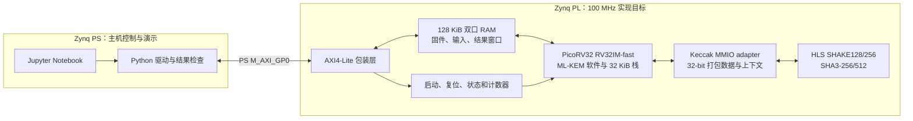
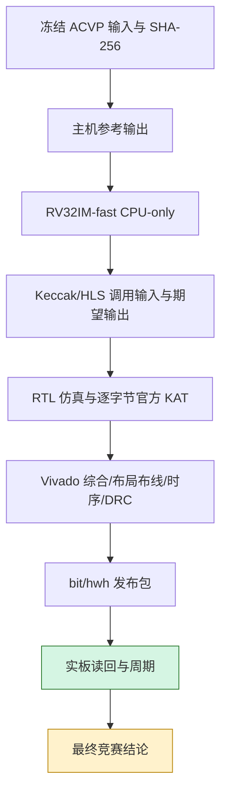
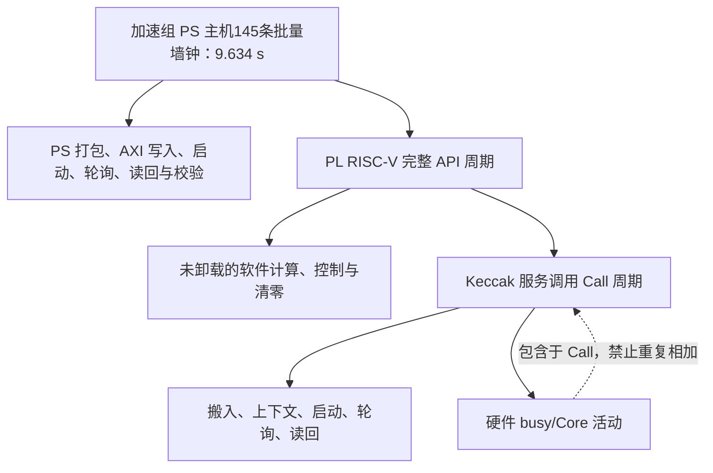
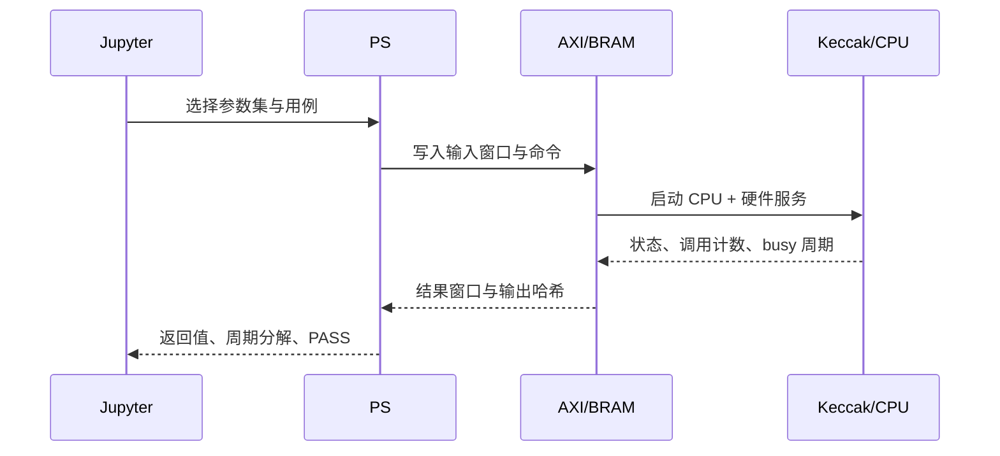

# 面向 PYNQ-Z2 的 ML-KEM-1024 软硬件协同加速系统

> 竞赛报告草案。本文只引用仓库中已有的可追溯证据；历史 RTL 仿真、独立 IP 实现和
> PS-PL 发布候选与板级测量分层记录，也不等同于 CAVP/FIPS 认证。

版本日期：2026-10-23。当前发布分支：`last`。本文为可编辑的工程报告母稿，
图表采用 Mermaid；正式提交时按竞赛格式排版，保留测量条件与证据链接。

## 1. 项目摘要

本项目面向资源受限的 PYNQ-Z2，构建 ML-KEM-1024（K=4）软硬件协同原型。设计以
PicoRV32 RV32IM-fast 作为软件执行基线，将 FIPS 202 中高调用量的 Keccak/SHAKE
运算抽象为可复用硬件服务，通过 BRAM 缓冲、MMIO/AXI 控制和上下文续取接口接入
标准 ML-KEM 软件路径。K=2 的 BaseMul 实现保留为历史对照，K=3 作为后续扩展，
不把 K=2 的测量直接外推到 K=4。

当前已形成完整的研究型证据链：主机参考回归、PicoRV32 CPU-only 基线、HLS
逐位等价验证、RTL 官方 KAT、Vivado 资源/时序报告和 PS-PL 部署包。2026-10-23，
在同一 PYNQ-Z2、同一 100 MHz overlay 上切换 CPU-only 与加速固件，两组各完成
145/145 官方记录验证。完整 API 周期从 1,699,293,290 降至 446,852,439，获得
**3.8028× 实板 API 加速**；包含 PS 上传、轮询、读回和校验的逐例事务墙钟合计
从 22.128 s 降至 9.627 s，获得 **2.2985× 实板 PS 事务加速**。两组代表用例各
重复 10 次及六项恢复检查均通过，验证了加速收益能够穿过现有接口落实到系统。

## 2. 系统结构



PS 负责装载和调度；完整 ML-KEM 软件运行在 PL 中的 RISC-V 软核上。PS 不是当前
3.8028x 对照中的软件基线，不能把这个比值说成“比 ARM 更快”。

HLS 将 25 个 Keccak lane 完整分区，按 24 轮执行置换；通过按 rate 分块的 32-bit
打包吸收/输出减少逐字节访存和变量取模成本。HASH/SQUEEZE/CLEAR 接口保存
SHAKE 上下文，输入/输出容量分别为 2048/4096 B；这不是 DMA 或零拷贝接口。
密码状态维持 64-bit lane 的逐位精确性，不使用有损量化。

设计边界如下：

- CPU-only、CPU+RTL 和 HLS 核使用独立的计时边界，避免把 Core 周期误写成完整
  KEM 加速比。
- 官方向量用于验证标准输出和调用负载；HLS 的 109 笔本地差分事务使用
  Python `hashlib`/OpenSSL 作为独立 oracle。
- PS-PL 墙钟来自板上 Python 计时，覆盖上传、等待、读回与校验；overlay 装载、
  固件装载/读回、证据文件保存及浏览器网络传输单独处理，不计入这一加速比。

## 3. 证据链



当前 PS-PL `bit/hwh` 已完成实现签核、2026-10-16 加速组全量实测和 2026-10-23
同板双固件配对实测。发布 manifest 保留生成时的
`physical_board_tested=false` 历史字段；实际证据单独归档于
`results/keccak_cpu/board/20261016_full145/` 和
`results/k4/paired_firmware/board_20261023/`。实板性能从新配对记录计算，历史 RTL
结论保持原值；功耗和浏览器网络端到端开销未测量。

## 4. 当前成果

| 层级 | 已有结果 | 证据边界 |
|---|---:|---|
| 主机 ML-KEM-512/768/1024 | 435 项官方记录通过 | 主机参考回归，不是 FPGA 结果 |
| K=4 RV32IM-fast CPU-only | 145/145 通过；1,699,294,360 cycles | RTL 仿真，128 KiB RAM / 32 KiB 栈 |
| K=4 CPU+Keccak RTL | `timing_decode_v3` 145/145；3,188 次真实启动/完成 | 冻结核心 RTL 仿真，不是新 AXI 全量覆盖 |
| K=4 历史 RTL API 周期对比 | 1,699,294,360 → 446,853,509；3.8028x | 官方用例混合，含 API 内搬运/等待/清零 |
| K=4 操作分组 | KeyGen 4.203x；Encaps 3.636x；Decaps 3.602x | 仅当前 RTL 仿真口径 |
| K=4 HLS 局部差分 | 109 笔 C/COSIM；opt02 75,280 cycles | FIPS 202 本地事务，不是完整 KEM |
| HLS 局部周期对比 | 1,314,553 → 75,280；17.462x | 不能写成系统端到端加速比 |
| K=4 独立 IP OOC | 100 MHz；WNS/WHS +0.279/+0.098 ns | 外部存储和 CPU 未计入 |
| K=4 独立 PL 自检 | 100 MHz；setup/hold +0.109/+0.027 ns | 用户报告 LED0 PASS/BTN0 恢复；无自动化读回证据 |
| PS-PL 同板双固件官方验证 | CPU-only 与 CPU+Keccak 各145/145；输出、返回码与计数逐条核对 | 同一 bitstream、RV32IM-fast、128/32 KiB |
| 同板完整 API 周期对比 | 1,699,293,290 → 446,852,439；**3.8028×** | 2026-10-23 实测；不含 PS 传输 |
| 同板 PS 事务墙钟对比 | 22.128 s → 9.627 s；**2.2985×** | 145 条逐例事务之和，包含上传/轮询/读回/校验 |
| 同板重复与恢复 | 两模式×三代表例×10 次全部通过；六项恢复通过 | 短时重复性与特定恢复路径，非长期可靠性评估 |
| K=2 历史 BaseMul | 145/145；端到端 0.9930x | 历史对照，说明接口开销问题 |

145 是指定公开数据集的记录数，包含有效/无效密钥检查及隐式拒绝，不能称为
145 次完整 KeyGen→Encaps→Decaps 工作流。数据集包含 `FIPS203` 和 `FIPS203-tr1`，
二者修订分别记录，后者不替代正式修订。每条按 dataset、revision、tgId、tcId 追踪。

关键资源记录直接引用对应 Vivado 路由报告；不混用 OOC、独立 PL 与 PS-PL 数据：

| 实现对象 | LUT | FF | BRAM36 等效 | DSP | setup / hold / pulse（ns） |
|---|---:|---:|---:|---:|---|
| 独立 PL 自检 `20261004_162430` | 19,030 | 16,963 | 34.5 | 4 | +0.109 / +0.027 / +2.000 |
| PS-PL overlay `20261005_psaxi06` | 19,759 | 17,585 | 34.5 | 4 | +0.302 / +0.026 / +3.750 |

PS-PL overlay 使用器件 LUT 37.14%、FF 16.53%、BRAM 24.64%、DSP 1.82%，
29,758/29,758 条网络完成布线，签核阻断 DRC 为 0。证明现有设计可在目标器件
实现；不证明额外模块一定能闭合时序，也不代表板级功耗或吞吐率。上述均为
100 MHz 约束下的签核结果，不是频率扫描测得的 Fmax。

发布候选 `release/mlkem1024_pynq/` 已保存以下配套哈希：`k4_accel.bit`
为 `8ecd6ba9f21fb6e3b51f5ea4c98c58090f85eb1002ee672a0d89bc151edf2cfb`，
`k4_accel.hwh` 为 `83bbb0f97a5be6c32946a13a86151cabc03203e829e154e99df57933bfe738cf`。
manifest 中的 `physical_board_tested=false` 是生成时的历史状态。2026-10-16
同一 bit/hwh 的145条加速组实板结果已独立归档，原始 manifest 未回写。2026-10-23
配对工作包保留相同 bit/hwh 和向量，新增双固件切换驱动与测量 Notebook；每次
在复位状态写入完整 128 KiB RAM 并读回核对，固件身份随原始记录保存。



这是计时范围图，不是已测得的时间占比图。1,980,263 个 HLS busy cycles、
257,851 次写入和 435,632 次读出均已包含于相应 API 区间；读写数单位是 32-bit
word，不是周期。`API - busy` 同时包含软件计算与接口成本，不能标为“搬运开销”。

### 实验可比性

核心 CPU-only 与 CPU+Keccak 比较统一为 RV32IM-fast、128 KiB RAM、32 KiB 栈、
相同官方记录和 API 计时边界。周期包含 API 内的硬件驱动、等待和清零，不含固件
启动、邮箱传输、oracle 检查和熵源采集；空计时区间保留。seed 解封装包含私钥重建。
3.8028x 是全部记录 CPU 周期之和除以加速周期之和，不是逐例加速比的算术平均，
也不是任意应用工作负载的固定收益。

2026-10-23 配对实验使用同一 bitstream：CPU-only 固件运行软件 FIPS 202，
加速固件调用 Keccak 服务。两者采用相同 RV32IM-fast、RAM/栈、编译优化级别、
官方输入及 API 计时位置；CPU-only 硬件启动/busy/读写计数均为零，加速组共
启动 3,188 次。同一 bitstream 始终保留 Keccak 电路，因此该实验衡量服务启用的
性能收益，不提供移除加速器后的面积或功耗差值，也不是 PS ARM 软件对照。

145 条 API 时间为 CPU-only 16.993 s、加速组 4.469 s；PS 批量墙钟为
22.135 s、9.634 s，对应 2.2976×。逐例事务墙钟之和为 22.128 s、9.627 s，
对应 2.2985×；两者差额是批次循环与记录开销。固件加载并读回分别耗时
2.197 s、2.170 s，单独记录，不计入 API、事务或批次计时。

2026-10-16 加速组历史测量仍保留：API 446,852,439 cycles，PS 批量墙钟
9.563 s，上传/等待/下载/校验合计 2.640/4.993/1.766/0.017 s。本次加速 API
周期与该历史实测一致；历史核心 RTL 数字 446,853,509 相差 1,070 周期，
CPU-only 历史 RTL 1,699,294,360 与本次实板也相差 1,070 周期，不相互覆盖。

## 5. 创新点与竞赛价值

本项目把高调用量的密码服务卸载落实为可运行、可测量的低成本 FPGA 系统，
主要贡献如下：

1. 以 ML-KEM-1024/K=4 为主线，选择标准软件真实调用量对应的 Keccak/FIPS 202
   工作负载，避免只优化一个脱离系统的 BaseMul 小核。
2. 在同板同 bitstream 上切换两种固件，固定 RV32IM-fast、RAM/栈和官方输入，
   取得 3.8028× 完整 API 加速和 2.2985× PS 事务加速；既验证硬件卸载的收益，
   也量化了主机接口对收益的压缩。
3. 从 HLS、RTL、PicoRV32、MMIO/BRAM、AXI 到 PYNQ Notebook 形成可复现的工程链路。
4. 保留 K=2 的 0.9930x 负结果，说明项目没有只挑选有利数据，而是识别了接口开销
   对端到端性能的影响。
5. 通过输入、输出、固件、向量、报告和 bitstream 哈希建立可追溯证据包，便于
   评委复核和后续迁移。

学术定位应保持克制：实现 Keccak、使用 HLS 或选择最高安全类别，本身不足以
证明算法或架构领先。当前较有力的研究问题是“在低成本 FPGA 上，接口粒度与
存储组织如何决定完整 ML-KEM 的收益”。若要进一步主张创新性，需补同器件或
归一化口径的相关工作对照、HLS 结构消融、接口成本分解及可行配置的资源/延迟
权衡。未完成这些对照前，不写“国际领先”“最优”或虚构排名。

## 6. 实用性评估

当前定位是**研究原型、教学平台和竞赛演示系统**。它已适合展示：

- 资源受限 FPGA 上的后量子密码软硬件协同设计；
- 标准算法调用映射到硬件服务的接口取舍；
- 性能、资源、时序和正确性之间的工程权衡。

它还不是产品级密码模块。正式产品化仍需板级长期运行、真实功耗/能效、随机源
和密钥生命周期审查、侧信道/故障注入评估、参数敏捷性验证以及正式认证流程。
报告不得使用“已获 CAVP/FIPS 认证”等表述。

ML-KEM 用于建立共享秘密，不直接加密应用大数据。应用演示可以说明它位于安全
通信握手的位置；当前系统没有实现 TLS、证书认证、随机源和完整会话密钥生命周期，
因此不将本原测试说成完整安全通信产品。可部署价值还需与 PS ARM 上的优化软件
比较；当前 RISC-V 软核加速结果不能证明优于板上 ARM。

### 6.1 设计取舍

| 选择 | 采用方案 | 原因 | 代价与边界 |
|---|---|---|---|
| 加速对象 | Keccak/SHAKE/FIPS 202 服务 | 覆盖 ML-KEM 中高调用量、可复用的标准运算 | 已测 3.8028× API、2.2985× PS 事务收益，接口仍有优化空间 |
| 软件执行体 | PicoRV32 RV32IM-fast | 固定软件环境，便于逐周期比较和迁移 | 不能直接代表 Zynq ARM 性能 |
| 数据交换 | BRAM 窗口 + MMIO/AXI | 结构简单、可观察、适合竞赛复现 | 不是 DMA/零拷贝，PS 传输会增加延迟 |
| 参数主线 | ML-KEM-1024/K=4 | 展示较高工作量和硬件服务复用价值 | 当前资源已签核；增量设计需重新实现，板级功耗未测 |
| 验证顺序 | HLS 差分 → RTL KAT → Vivado → 实板 | 每一步都有可定位的失败边界 | 双固件145条实板验收已完成，后续改版需回归 |
| 报告口径 | API、Call、Core 分层 | 防止把局部核加速误写成系统加速 | 图表和演示需要解释计时包含关系 |

这组取舍把“先进性”落实为可审计的系统问题：硬件服务覆盖了多少真实调用、
接口带来的固定成本是多少、资源和时序是否仍能闭合。若板上数据表明 PS 传输
成为主导项，应优先调整批处理粒度、窗口布局和启动协议，而不是只追求更高的
Keccak 内部并行度。

### 6.2 已执行实验矩阵

每个实验固定参数集、输入快照、固件/bit 哈希、时钟约束、计时边界和重复次数；
原始 JSON 包含逐条输出、计数与环境信息，离线核对后生成汇总。

| 实验 | 变量 | 输出 | 当前状态 |
|---|---|---|---|
| 正确性 | 同一官方145条记录、两种固件 | 官方输出、返回码、硬件计数 | 两组各145/145通过 |
| 重复性 | 两种固件，索引0/1/115，各10次 | API周期、PS墙钟、逐条输出 | 60/60通过；各组固定输入的API周期无波动 |
| 恢复 | 两模式分别复位、错误magic、主动超时 | 注入状态及恢复后的官方输出 | 6/6通过，包含预期TimeoutError证据 |
| 性能 | 同板CPU-only与CPU+服务 | API、busy、PS事务及批次墙钟 | API 3.8028×、PS事务2.2985× |
| 资源 | 独立 IP、PS-PL overlay | LUT/FF/BRAM/DSP、WNS/WHS | 已有实现签核；增量设计需重签 |
| 证据追溯 | 向量、固件、bit/hwh、驱动及RAM读回 | SHA-256、版本、时间戳、逐条输入输出 | 原始ZIP、JSON与离线核验结果单独归档 |

重复性实验按 CPU-only 块、加速块顺序执行，并非随机交错测量。其结论是本次
短时运行下的重复性；小时级压力测试、温度变化和系统负载变化尚未评估。

### 6.3 风险与缓解

| 风险 | 可能表现 | 缓解动作 | 当前状态 |
|---|---|---|---|
| PS 传输压缩 PL 收益 | PS墙钟加速比小于API周期加速比 | 增大批量、减少轮询、报告分层计时 | 已测3.8028× API与2.2985× PS事务；仍有净收益 |
| 地址/复位协议错误 | 卡死、旧结果残留、重复运行失败 | 扩大协议异常覆盖，保留失败状态与恢复输出 | 已通过复位、错误magic及超时恢复；未覆盖任意地址故障 |
| 资源增量无法闭合 | WNS 变负或 BRAM 不足 | 先冻结已签核版本，再逐项加模块 | 当前候选已闭合 |
| 证据口径混淆 | 把局部 HLS 或旧 RTL 数字写成板上结果 | 每项结果标注来源、边界和哈希 | 已在本报告区分 |
| 板卡环境变化 | PYNQ/Python/时钟版本不同 | 启动时记录系统信息与 bit/hwh 哈希 | 已记录PYNQ 2.5 / Python 3.6.5 / Linux 4.19 |
| 长时间 KAT 影响演示 | 现场等待或网络中断 | 代表例现场演示，145 条作为归档验收 | 方案已确定 |

### 6.4 后续工作与主线边界

主线功能、时序实现、官方全量实板验证及同板性能对照已经形成闭环，可以据此
撰写和提交竞赛技术报告。剩余工作分为材料完善与研究扩展：

| 工作 | 用途 | 是否影响当前主线结论 |
|---|---|---|
| 相关工作同口径对照、正式排版与演示录屏 | 展示贡献位置与复现方法 | 不改变已测数据，提交前完成 |
| HLS结构与接口粒度消融 | 解释各优化项贡献，支持更强学术主张 | 未做前不声称各项独立收益 |
| PS ARM优化软件对照 | 判断软核方案相对板上应用处理器的实际部署优势 | 当前结论仅相对RV32IM-fast |
| 仪器测功耗、长时压力和温度测试 | 能效与持续运行能力 | 当前不宣称能效或长期可靠性 |
| 随机源、密钥生命周期、侧信道与故障注入 | 产品化安全评估 | 当前定位研究原型 |

## 7. 2026-10-23 实板配对结果

测试环境为 PYNQ-Z2、PYNQ 2.5、Python 3.6.5、Linux 4.19，PL 时钟100 MHz。
两模式共用同一已签核 bit/hwh 和官方向量，在CPU复位时完整替换固件并读回。
以下总量均由145条记录求和，不是各例加速比的算术平均。

| 指标 | CPU-only | CPU+Keccak | CPU-only / 加速组 |
|---|---:|---:|---:|
| 官方记录唯一覆盖 | 145/145 | 145/145 | — |
| 完整API原始周期 | 1,699,293,290 | 446,852,439 | **3.8028×** |
| API时间（100 MHz） | 16.992933 s | 4.468524 s | 3.8028× |
| 逐例PS事务墙钟之和 | 22.128231 s | 9.627048 s | **2.2985×** |
| 批次墙钟 | 22.135449 s | 9.634240 s | 2.2976× |
| 固件装载与读回（单独计时） | 2.197310 s | 2.170197 s | 不计入性能比值 |
| Keccak硬件启动数 | 0 | 3,188 | — |

上传和读回的绝对成本在两组中接近，因此完整API提速不会等比例转化为PS事务
提速。CPU-only上传/等待/下载合计为2.641/17.470/1.817 s，加速组为
2.641/4.981/1.813 s。等待包含API执行，上传包含打包；这三个量与API不能
重复相加。PS墙钟计入驱动及官方输出核对，未计入浏览器网络和证据文件保存。

三种代表操作在两模式下分别重复10次，60条输出全部通过。固定输入下的原始
API周期在各自10次中完全一致；PS墙钟受主机调度等影响，统计如下：

| 模式 / 索引 / 操作 | API cycles（10次相同） | PS墙钟最小（ms） | 中位数（ms） | P95 / 最大（ms） |
|---|---:|---:|---:|---:|
| CPU-only / 0 / KeyGen | 13,046,690 | 193.560 | 193.987 | 194.425 |
| CPU-only / 1 / Encaps | 13,908,285 | 175.659 | 175.892 | 176.121 |
| CPU-only / 115 / Decaps | 17,088,701 | 197.828 | 198.003 | 198.236 |
| CPU+Keccak / 0 / KeyGen | 3,120,941 | 94.427 | 94.677 | 95.225 |
| CPU+Keccak / 1 / Encaps | 3,841,521 | 75.119 | 75.316 | 75.517 |
| CPU+Keccak / 115 / Decaps | 4,658,615 | 73.524 | 73.611 | 73.783 |

P95采用最近秩 `ceil(0.95×n)`；本次n=10，P95恰为最大值，不代表高置信度尾延迟。
恢复检查在两模式下分别执行复位、错误邮箱magic与主动设置极短主机超时。
错误magic返回固件错误码2且未启动Keccak；主动超时产生预期TimeoutError，
随后复位并运行有效官方用例成功。六项检查证明这些具体恢复路径可用，
不等同于覆盖任意非法命令、非法地址或物理故障。

## 8. 建议的竞赛展示顺序



现场建议按“装载与版本核对 → KeyGen/Encaps/Decaps 代表用例 → 性能/资源解释”组织，目标约两分钟，具体时长待板上演练确认。
默认演示索引0、1、115，完整145条结果作为归档证据。页面展示同板双固件
3.8028× API加速、2.2985× PS事务加速和测试条件，提供原始JSON入口；历史RTL
结果另列来源，不用主机模拟的PASS替代实板结果。

## 9. 报告结论模板

> 本项目完成了面向PYNQ-Z2的ML-KEM-1024/K=4软硬件协同加速系统。在同一
> 100 MHz overlay、RV32IM-fast、128 KiB RAM / 32 KiB栈下切换软件与加速固件，
> 两组各通过145条官方记录，完整API周期由1,699,293,290降至446,852,439，
> 实测加速3.8028×；计入PS上传、轮询、读回和核对后，逐例事务墙钟总和由
> 22.128 s降至9.627 s，仍取得2.2985×加速。三代表操作两模式各10次重复和
> 六项恢复检查通过。设计使用19,759 LUT、34.5 BRAM36等效与4 DSP，完成
> 100 MHz时序签核。这表明高调用量Keccak服务的硬件卸载能在资源受限平台上
> 提供完整ML-KEM工作负载的实际收益；功耗、长期可靠性及产品化安全仍需扩展验证。

## 10. 证据入口

- 项目状态：[PROJECT_STATUS.md](PROJECT_STATUS.md)
- 同板双固件实测与离线核验：[20261023配对结果](../results/k4/paired_firmware/board_20261023/summary.md)
- 实板全量与独立复核：[20261016_full145](../results/keccak_cpu/board/20261016_full145/README.md)
- 路线与阶段门：[COMPETITION_ROADMAP.md](COMPETITION_ROADMAP.md)
- 性能台账：[BENCHMARKS.md](BENCHMARKS.md)
- K4 主线入口：[../mainline/k4/README.md](../mainline/k4/README.md)
- K4 HLS 说明：[../mainline/k4/hls/README.md](../mainline/k4/hls/README.md)
- 冻结核心全量汇总：[../results/keccak_cpu/candidates/timing_decode_v3/kat/summary.md](../results/keccak_cpu/candidates/timing_decode_v3/kat/summary.md)
- CPU-only 对照：[../results/official_baseline/mlkem1024/rv32im_fast/summary.md](../results/official_baseline/mlkem1024/rv32im_fast/summary.md)
- HLS 局部对比：[../results/hls/mlkem1024_keccak/summary.md](../results/hls/mlkem1024_keccak/summary.md)
- 官方输入来源与修订：[../vectors/official_kat/acvp/SOURCES.md](../vectors/official_kat/acvp/SOURCES.md)
- K4 板前实现签核：[../results/keccak_cpu/board/20261004_162430/result.json](../results/keccak_cpu/board/20261004_162430/result.json)
- PS-PL 实现候选：[../results/keccak_cpu/pynq/20261005_psaxi06/result.json](../results/keccak_cpu/pynq/20261005_psaxi06/result.json)
- 发布包：[../release/mlkem1024_pynq/README.txt](../release/mlkem1024_pynq/README.txt)

### 复现入口

从仓库根目录、已配置 Vivado/Vitis HLS 2024.2 的终端运行：

```powershell
tclsh mainline/k4/flow.tcl
vivado -mode batch -source mainline/k4/bd_axi.tcl
python mainline/k4/hls/scripts/generate_vectors.py --check
python mainline/k4/hls/scripts/collect_reports.py collect --run-dir build/k4/hls_io/opt02 --strict
```

`flow.tcl` 负责 HLS、CPU smoke、代表性 KAT 和独立 PL 阶段；`bd_axi.tcl` 负责
PS-PL Block Design、AXI 子集验证、综合/实现和 overlay 导出。实际运行前应检查
两个 Tcl 顶部开关和 `CHECK_ONLY`，生成目录应放在 `build/` 或短路径外部目录，
不能把 Vivado/HLS cache 当成源码或提交产物。发布目录中的 `.bit/.hwh` 必须与
`release_manifest.json` 配套，报告中使用其 SHA-256。
